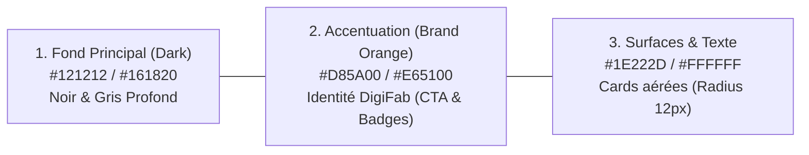

# 📘 Guide Complet & Documentation Technique : Plateforme d'Arbitrage, Pricing & Annonces V1

**Auteur :** Larabi Kdider  
**Cours :** 420-D30-BB Développement et Déploiement de Solutions  
**Version :** V1.0 - Production  
**Design System :** DigiFab Dark Theme (3 Couleurs Principales : `#121212` Dark, `#E65100` Brand Orange, `#1E222D` Surface & White)

---

## 🎨 Volet 1 : Le Design System à 3 Teintes Principales (SaaS B2B)

L'application a été entièrement restylée selon une charte graphique épurée et moderne de type SaaS d'entreprise :

* **Fond Principal (`#121212` / `#161820`) :** Élimine la fatigue visuelle, met en valeur les données financières et confère un aspect salle des marchés / cockpit d'arbitrage.
* **Couleur d'Accentuation (`#E65100` / `#D85A00` - Brand Orange DigiFab) :** Appliquée avec rigueur sur tous les boutons d'action prioritaires (CTA), les curseurs dynamiques, les lueurs d'état et les onglets actifs.
* **Surfaces & Typographie (`#1E222D` / `#FFFFFF` / `#94A3B8`) :** Conteneurs de cartes aérés avec ombres douces (`box-shadow`), bordures subtiles (`rgba(255,255,255,0.08)`), police moderne *Plus Jakarta Sans* et hiérarchie visuelle stricte.

---

## 📑 Volet 2 : Documentation & Explication de chaque Partie et Tableau

---

### 1. Page 1 : Dashboard Global & Arbitrage (LightGBM / CatBoost)

Ce tableau de bord centralise en temps réel la prise de décision financière et le filtrage des opportunités sous-évaluées.

#### A. Les 4 Blocs KPIs Stratégiques
1. **🎯 Offres Détectées :** 
   - *Rôle :* Nombre total d'articles actuellement en vente dont le prix d'achat proposé est significativement inférieur à la valeur marchande calculée par le modèle.
   - *Impact Métier :* Donne la taille du portefeuille d'opportunités immédiates disponibles pour l'arbitragiste.
2. **💰 Gain Net Cumulé (-13.25% Frais Déduits) :**
   - *Rôle :* Somme algébrique des profits nets espérés (\$ CAD/USD) sur toutes les offres qualifiées.
   - *Formule mathématique sous-jacente :*
     $$\text{Gain Net} = \text{Fair Price Prédit } (Q_{50}) - [\text{Prix Achat} + \text{Frais de Port} + (\text{Fair Price} \times 0.1325 + 0.30)]$$
   - *Garantie :* Aucun gain n'est calculé "brut" ; chaque centime prend en compte la commission plateforme et la livraison.
3. **📈 Marge ROI Moyenne (%) :**
   - *Rôle :* Rentabilité moyenne des capitaux engagés ($ROI = \frac{\text{Gain Net}}{\text{Coût Total d'Acquisition}}$).
   - *Seuil de déclenchement :* Configuré par défaut à **$\ge 20\%$** dans la barre latérale.
4. **⚡ Score Vélocité Ratio Moy. :**
   - *Rôle :* Mesure la liquidité du marché pour ce modèle d'article :
     $$\text{Vélocité} = \frac{\text{Nombre de Ventes Terminées Récentes (30j)}}{\text{Nombre d'Annonces Actuellement en Vente}}$$
   - *Interprétation :* Un ratio $> 3.0\times$ indique un produit qui se revend en moins de 10 jours ouvrés.

#### B. Rôle des Filtres d'Arbitrage
* **Filtre Catégories Autorisées :** Restreint l'analyse aux secteurs stratégiques approuvés en administration (ex: *Industrial/Automation*, *Networking/Hardware*).
* **Curseurs Marge Minimale (%) et Gain Net Minimum ($) :** Filtrent en direct le tableau pour éliminer les micro-opportunités non rentables après manutention.
* **Sélecteur de Produit & Grade de Condition :** Permet d'isoler une référence spécifique (ex: *Advantech MIC-770H*, *Netgate 6100*) et de filtrer selon l'état réel (Neuf, Reconditionné Grade A, Occasion fonctionnelle, Pour pièces).

#### C. Fiche Produit & Graphique d'Intervalle de Confiance LightGBM
* **Fair Price Médian ($Q_{50}$) :** Estimation robuste de la valeur de revente sur le marché secondaire.
* **Bande de Confiance [$Q_{10} - Q_{90}$] :** Modélisation probabiliste par régression quantile :
  - **$Q_{10}$ (Scénario pessimiste) :** Prix auquel l'article se vendra même en cas de baisse brutale du marché.
  - **$Q_{90}$ (Scénario optimiste) :** Prix maximal atteignable avec une annonce de qualité supérieure.
* **Règle d'or de l'Arbitrage :** L'alerte est déclarée "Sûre" uniquement si :
  $$\text{Prix Achat} + \text{Frais Total} < Q_{10}$$

---

### 2. Page 2 : Fiche Descriptive & Annonce eBay Pro (High Conversion)

Cette interface transforme une donnée brute d'opportunité en une **annonce eBay vendeuse prête à être publiée**, optimisée pour l'algorithme SEO Cassini d'eBay.

#### A. Sélecteur de Gabarits Constructeur (16 Gabarits Dédiés)
* **Utilité :** Contient des profils pré-remplis pour les grandes marques industrielles et high-tech (*Advantech, Neogen Raptor, FLIR, Netgate pfSense, StarTech, Apple, Dell, Sony, Rolex, Nike, etc.*).
* **Contenu injecté automatiquement :**
  - **Titre SEO calibré :** Garanti $\le 80$ caractères avec mots-clés stratégiques (*Marque, Modèle, Référence constructeur MPN, État*).
  - **Code Douanier SH (Harmonized System) :** Indispensable pour la conformité export et l'expédition transfrontalière sans blocage douanier.
  - **Matrice Technique :** Tableau bicolore de 10 à 12 spécifications rigoureuses (processeur, tension d'alimentation, plage de température, connectique E/S, indice de protection).

#### B. Module Multi-Sources de Synchronisation Photos HD
* **Mode 1 - Synchronisation Base :** Charge instantanément les 4 photos officielles associées au gabarit présélectionné.
* **Mode 2 - URL Web Directe :** Analyse n'importe quelle page web (site fabricant ou annonce concurrente), parse les métadonnées OpenGraph (`og:image`) et extrait la galerie d'images.
* **Mode 3 - Scraping Dynamique :** Interroge les moteurs de recherche pour récupérer les visuels haute définition les plus récents.

#### C. Galerie Photos HD Contractuelle (4 Angles Clés) & Outil d'Upload
* **Angle 1 :** Face avant & Vue d'ensemble (Aperçu global).
* **Angle 2 :** Connectique, Ports E/S & Interfaces arrières.
* **Angle 3 :** Plaque signalétique constructeur, numéro de série et label CE/FCC.
* **Angle 4 :** Packaging officiel, câbles et accessoires inclus.
* **Zone d'Upload :** Permet à l'opérateur d'importer directement des clichés pris en atelier avec son smartphone ou un appareil photo pour remplacer les visuels de catalogue.

---

### 3. Page 3 : Ingestion & Recherche en Direct (API eBay REST)

Ce module assure l'acquisition de données en temps réel via les protocoles officiels d'eBay.

#### A. Paramètres de Requêtage Direct
* **Mot-clé / Référence exacte :** Requête ciblée interrogeant l'API `browse.item_summary/search`.
* **Sélecteur de Pays (Marketplace) :**
  - Permet de basculer instantanément entre *ebay.ca (CAD)*, *ebay.com (USD)*, *ebay.fr (EUR)*, *ebay.co.uk (GBP)* ou *ebay.de (EUR)*.
  - Ajuste automatiquement les devises et les taux de change dans les calculs d'arbitrage.
* **Condition de l'Item :** Filtre natif eBay pour n'ingérer que l'état recherché (*New, Certified Refurbished, Seller Refurbished, Used, For Parts*).

#### B. Connexion Streaming Kafka & Persistance Cassandra
* **Apache Kafka :** Dès que les 30 annonces sont extraites, elles sont publiées sous forme de messages JSON dans le topic partitionné `raw-listings`.
* **Apache Cassandra :** Les annonces sont insérées dans la table `arbitrage_alerts` du keyspace `ecommerce_arbitrage`, garantissant une disponibilité permanente même en cas de coupure de l'API.

---

### 4. Page 4 : Données de Ventes Réelles & CSV (eBay Sold Listings)

Ce volet constitue le socle de vérité historique de l'intelligence artificielle.

#### A. Web Scraping Quotidien Automatisé (Airflow DAG à 03:00 UTC)
* **Planification :** Exécution récurrente programmée par Apache Airflow chaque nuit à **03:00 UTC**.
* **Pourquoi cette heure ?** Minimise le risque de détection anti-bot, évite la saturation réseau et garantit la prise en compte de toutes les enchères terminées de la veille.
* **Principe :** Scrape les annonces *Sold & Completed* (ventes réellement payées) pour tous les produits enregistrés en base, afin de recalibrer les modèles prédictifs.

#### B. Rôle des 4 Sites Web Industriels Partenaires
1. **🏭 AutomationDirect (`automationdirect.com`) :** Référence transactionnelle pour les automates programmables (PLC), variateurs (VFD), servomoteurs et HMI. Fournit des cotations matérielles neuves fiables.
2. **⚙️ Radwell Canada (`radwell.ca`) :** Leader mondial des pièces de remplacement industrielles obsolètes, surplus neufs et reconditionnés. Permet de coter les pièces introuvables sur le marché classique.
3. **🔌 RS Canada (`ca.rs-online.com`) :** Distributeur multimarque offrant des fiches techniques certifiées et des prix de référence industriels.
4. **⚡ DigiKey Canada (`digikey.ca`) :** Moteur de recherche avancé par tolérances électriques, boîtiers et disponibilité en stock.

#### C. Tableau de Paramétrage des Cotations & Export CSV
* **Données Présentées :** Prix effectif de clôture, date de transaction, frais réels perçus par eBay, délai de vente (vélocité).
* **Bouton d'Export CSV :** Télécharge l'historique complet pour des audits financiers ou pour l'entraînement de modèles de régression externes.

---

### 5. Page 5 : Zone Administrateur Sécurisée

Ce module garantit la gouvernance, la conformité et la sécurité des accès à la plateforme.

#### A. Authentification & Protection par Mot de Passe
* **Contrôle d'Accès :** Zone verrouillée par mot de passe administrateur persistant dans la session Streamlit.
* **Déconnexion Sécurisée :** Bouton de révocation immédiate de session pour empêcher tout accès non autorisé sur un poste partagé.

#### B. Gestion des Clés API eBay (Stockage Sécurisé & Masquage)
* **Chiffrement / Masquage :** Les clés `Client ID` et `Client Secret` sont masquées à l'écran (`••••••••`) et stockées dans un fichier de configuration isolé (`config/ebay_credentials.json`).
* **Sélecteur d'Environnement :** Permet de basculer en un clic entre le mode `SANDBOX` (environnement d'essai sans frais) et `PRODUCTION` (transactions commerciales réelles).

#### C. Contrôle des Catégories Autorisées
* **Gestion du Périmètre :** Permet d'ajouter ou de révoquer des catégories de produits (ex: interdire les catégories hors cœur de métier pour concentrer les capitaux sur les équipements à forte marge).

#### D. Gestion des Accès Utilisateurs (RBAC)
* **Attribution des Rôles :**
  - **Super Admin :** Accès total aux configurations, clés d'API et catégories.
  - **Data Engineer :** Accès aux pipelines de données, logs Airflow et ré-entraînement des modèles.
  - **Trader / Analyst :** Accès en lecture et exécution sur le dashboard d'arbitrage et la rédaction d'annonces.
