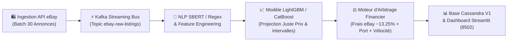
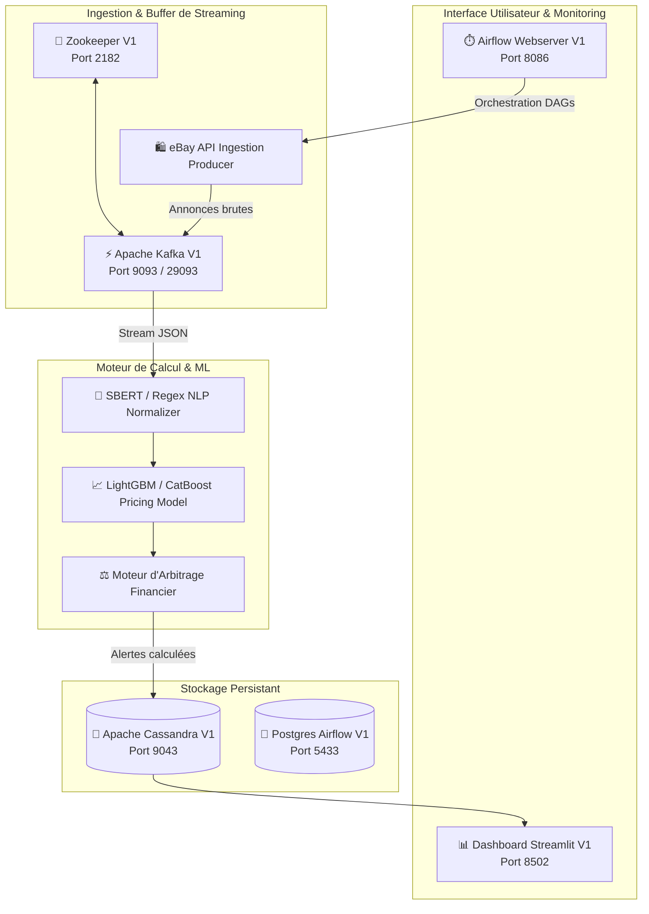
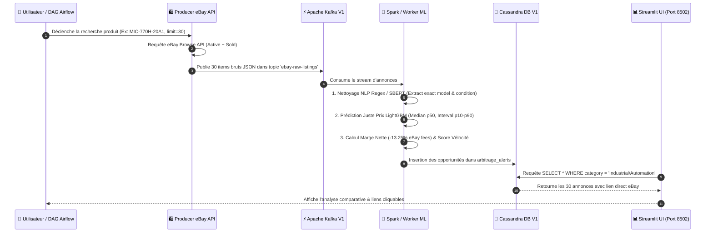

# Présentation Technique Complète — Plateforme d'Arbitrage E-Commerce Big Data & ML (V1)

Cette documentation présente l'architecture complète, les choix technologiques, le pipeline de données et les modèles mathématiques/financiers mis en œuvre dans la version **V1** de la plateforme d'arbitrage e-commerce.

---

## 1. Vision & Objectifs Business

La plateforme d'arbitrage e-commerce a pour objectif d'identifier automatiquement et en temps réel des **opportunités d'achat-revente à forte marge nette** sur eBay.



### Principaux Enjeux Répondus :
1. **Élimination du bruit d'évaluation** : Extraction précise du modèle exact par NLP (ex: différencier un PC industriel `MIC-770H-20A1` d'une carte réseau ou d'un téléphone).
2. **Estimation Objective du Prix de Marché (Fair Price)** : Entraînement d'un régresseur quantile LightGBM pour projeter le prix médian de vente et ses bornes d'incertitude (10% - 90%).
3. **Marge Nette Réelle** : Calcul strict incluant tous les coûts masqués (prix d'achat, frais d'expédition, commissions eBay ~13.25% + $0.30$, taxes d'importation).
4. **Analyse Comparative sur 30 Articles** : Analyse statistique par lot de 30 annonces identiques avec liens directs vers les annonces eBay.

---

## 2. Architecture Globale Big Data (Stack Docker V1)

L'ensemble des services de la plateforme **V1** est conteneurisé sous Docker et s'exécute de façon autonome sur des ports dédiés afin de garantir une isolation totale vis-à-vis des environnements existants.



### Tableau des Ports & Services Docker V1

| Conteneur Docker | Composant / Rôle | Port Interne | Port Hôte Externe |
| :--- | :--- | :--- | :--- |
| `streamlit-dashboard-v1` | Interface graphique d'analyse & alertes | `8501` | **`8502`** |
| `kafka-v1` | Message Broker (Topic `ebay-raw-listings`) | `9092/9093` | **`9093 / 29093`** |
| `zookeeper-v1` | Coordination du cluster Kafka | `2181` | **`2182`** |
| `cassandra-v1` | Stockage NoSQL haute performance | `9042` | **`9043`** |
| `airflow-webserver-v1` | Orchestrateur de pipelines batch & streaming | `8080` | **`8086`** |
| `airflow-postgres-v1` | Métabase d'état Airflow | `5432` | **`5433`** |

---

## 3. Technologies & Composants Clés

1. **eBay Buy/Browse REST API**
   - Ingestion en temps réel des annonces actives (*Active Listings*) et des historiques de ventes complétées (*Sold Listings*).
   - Récupération systématique d'un lot de **30 articles par recherche** avec extraction du lien officiel `https://www.ebay.com/itm/{raw_id}`.

2. **Traitement NLP & Normalisation (SBERT / Regex)**
   - Normalisation textuelle pour extraire la marque, la série et la référence exacte.
   - Classification et pondération de l'état (*Condition Grade*) :
     - **Brand New** : $1.00$
     - **Refurbished** : $0.85$
     - **Used / Pre-Owned** : $0.70$
     - **For Parts / Not Working** : $0.35$

3. **Modèle de Pricing ML (LightGBM Quantile Regression)**
   - Régression par arbre de décision sur gradient boosting (LightGBM) avec fonction de perte Quantile Loss ($\alpha = 0.10, 0.50, 0.90$).
   - Fournit non seulement la valeur marchande projetée ($\text{Fair Market Price} = \text{Quantile}_{0.50}$), mais également l'intervalle de confiance $[\text{P}_{10\%}, \text{P}_{90\%}]$.

4. **Moteur d'Arbitrage Financier**
   - **Calcul de Marge Nette Strict** :
     $$\text{Marge Nette} = \text{Prix Marché Projeté} - \left( \text{Prix Achat} + \text{Port} + \text{Frais eBay} + \text{Marge Cible} \right)$$
   - **Commission eBay** : $13.25\% \times \text{Prix de Vente Projeté} + \$0.30$.
   - **Score de Vélocité (Velocity Ratio)** :
     $$\text{Velocity Ratio} = \frac{\text{Nombre d'annonces vendues (Past Sold)}}{\text{Nombre d'annonces actives (Active Listings)}}$$

5. **Base de Données Cassandra V1**
   - Base NoSQL distribuée. Clé de partition primaire : `((category), arbitrage_score, product_id, timestamp)`.
   - Permet des requêtes de consultation ultra-rapides triées par score d'opportunité croissant ou décroissant.

6. **Dashboard Streamlit V1**
   - Filtrage séquentiel à 2 niveaux : **Catégorie d'abord**, puis **Produit**.
   - Zone Administration sécurisée (Mot de passe `admin123`) pour ajouter de nouvelles catégories et associer les produits sans saisie libre vulnérable.
   - Restitution graphique complète avec Plotly (Scatter plot Prix Achat vs Juste Prix & Camembert d'état).

---

## 4. Flux de Données Détaillé (Data Pipeline)



---

## 5. Visualisateur Interactif du Flux de Données

Le schéma interactif dynamique est disponible sous forme d'artefact HTML visuel :
👉 **[Schéma Interactif du Flux de Données (HTML)](file:///C:/Users/larabi.kdider/.gemini/antigravity/brain/3d98c104-5612-499c-af78-567914ca06ca/interactive_data_flow.html)**

---

## 6. Guide de Démarrage Rapide

### Accès au Dashboard
Ouvrez votre navigateur web à l'adresse : **`http://localhost:8502`**

### Exécution manuelle d'une ingestion de 30 articles :
```bash
docker exec streamlit-dashboard-v1 python /app/producers/ebay_api_producer.py
```

### Vérification de l'état des conteneurs :
```bash
docker ps --format "table {{.Names}}\t{{.Status}}\t{{.Ports}}"
```
